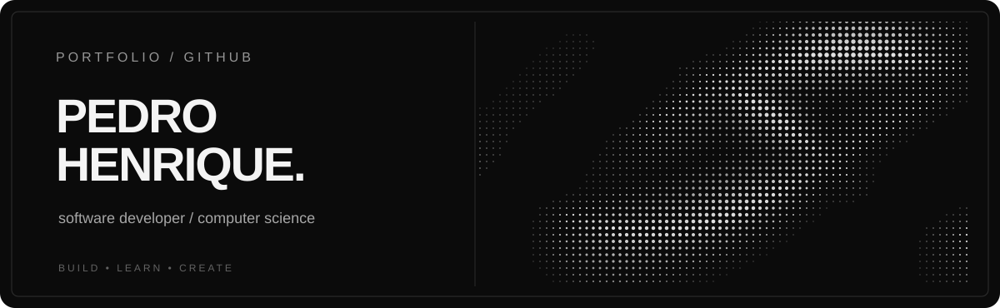

<!-- PROFILE README | Minimal / Monochrome / Halftone -->

  

 

<table>
<tr>
<td width="58%" valign="top">

### 01 / SOBRE MIM

**Olá, sou o Pedro Henrique.**

Desenvolvedor de software e estudante de Ciência da Computação.

Gosto de criar soluções, experimentar tecnologias e transformar ideias em projetos.

</td>
<td width="42%" valign="top">

### 02 / EM FOCO

`DESENVOLVIMENTO WEB`  
`BACK-END & FRONT-END`  
`APRENDIZADO CONTÍNUO`

</td>
</tr>
</table>

 

### 03 / TECH STACK

  

 

### 04 / GITHUB ACTIVITY

  
    
  

 

  DESIGN MINIMALISTA · MONOCROMÁTICO · EM CONSTANTE EVOLUÇÃO

