<!-- Gerado por scripts/generate.mjs — edite data/profile.json, não este arquivo. -->

 

 

<a href="https://www.linkedin.com/in/pedro-henrique-boligon-mathias-7ab066308"><code>LINKEDIN</code></a> &nbsp;·&nbsp; <a href="https://curriculopedroboligon.vercel.app"><code>PORTFÓLIO</code></a> &nbsp;·&nbsp; <a href="mailto:boligon.pedro@gmail.com"><code>EMAIL</code></a>

